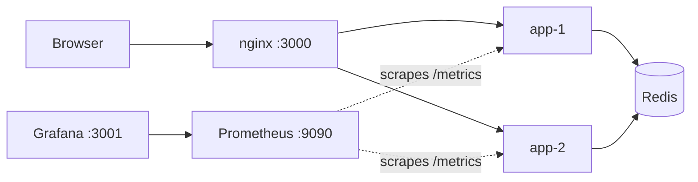
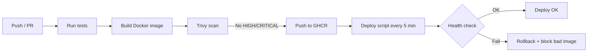

<div align="center">
  
</div>

<p align="center">
  🌸 ☁️ 💻 ✨ 🌿 ☁️ 🌸
</p>

<div align="center">
  
</div>

<p align="center">
  
  
  
  
</p>

<br>

---

## ✦ About Me

- 🎓 MCA First Year, Guru Nanak Institute of Management & Studies.  
- 🛠️ I learn by building: ship an app, break it on purpose, then fix the pipeline
- 🧠 Currently focused on containers, CI/CD, monitoring, and infrastructure as code
- 📫 darshanaambekar07@gmail.com · https://www.linkedin.com/in/darshana-ambekar-8964b6243

---

## 🎯 What I'm Working Toward

- **Containers:** Docker and Docker Compose for multi-service apps
- **CI/CD:** GitHub Actions pipelines with tests, image scanning, and registry pushes
- **Deployment:** Pull-based auto-deploy with health checks and automatic rollback
- **Monitoring:** Prometheus metrics and Grafana dashboards
- **Infrastructure as code:** Terraform workflow (init, plan, apply, destroy)

---

## 🛠️ Tech Stack

**DevOps & Infrastructure**


**Backend & Languages**


**Tools**


---

## 🚀 Featured Projects

### 🏁 Pixel Racers: DevOps Showcase

A multiplayer typing race with pixel-art racers. Players create a room, share the link, and race friends in real time. The game is the practice material. The focus is on building, shipping, and monitoring it reliably.

**Stack:** Node.js · Express · Socket.IO · Redis · nginx · Docker Compose · GitHub Actions · Trivy · Terraform · Prometheus · Grafana

**Architecture**



**CI/CD Pipeline**



**Highlights**

- Two app replicas behind nginx, sharing state through Redis
- CI fails the build on HIGH or CRITICAL vulnerabilities (Trivy)
- Pull-based CD with health check and automatic rollback
- Rollback tested with a deliberately broken image
- Prometheus metrics for players, races, HTTP status, and memory
- Failure demo: stopping one replica kept the game running

<details>
<summary>▸ Rollback test log (what actually happened)</summary>

```
16:22:15  Deploying new image sha256:6599daad... (old: 1d25a8...)
16:23:40  Health check FAILED
16:23:46  Rolled back to sha256:1d25a8...
16:27:12  Latest image is known-bad, skipping   (repeated every 5 min)
16:37:15  Deploying new image sha256:dbb63a...  (after git revert)
16:37:22  Deploy OK
```

</details>

<details>
<summary>▸ Honest limitations</summary>

- Runs on my local machine only. Nothing is exposed to the internet, and no cloud was used.
- The CD script updates only the app image. Changes to compose, nginx, or Prometheus config need a manual `docker compose up -d`.
- Self-hosted runners were avoided on purpose because the repo is public.
- Rollback only catches failures found by the health check at deploy time.
- The Grafana dashboard JSON is exported to the repo, but it is not auto-provisioned.

</details>

🔗 [Repository](https://github.com/AmbekarDarshana/typing-race)

---

### 🛡️ Argus AI Surveillance

A scalable, multi-tenant video surveillance platform that uses YOLOv8 to turn camera feeds into behavioral alerts, with role-based access for admins and clients.

**Stack:** Python · Flask · OpenCV · YOLOv8 · PyTorch · MongoDB Atlas · Waitress · Bootstrap 5

**Features**

- Real-time detection of unauthorized persons, weapons, vehicles in restricted zones, and fallen individuals
- Severity-based alerts (CRITICAL, WARNING, INFO) with snapshot evidence
- RTSP, webcam, and MP4/AVI input support
- Role-based access control with per-tenant data isolation
- Daily and weekly threat analytics via MongoDB aggregation pipelines

🔗 [Repository](https://github.com/AmbekarDarshana/Argus-ai-surveillance)

---

## 📊 GitHub Stats


---

<div align="center">

✨ *Learning by shipping, one pipeline at a time* ✨

</div>
